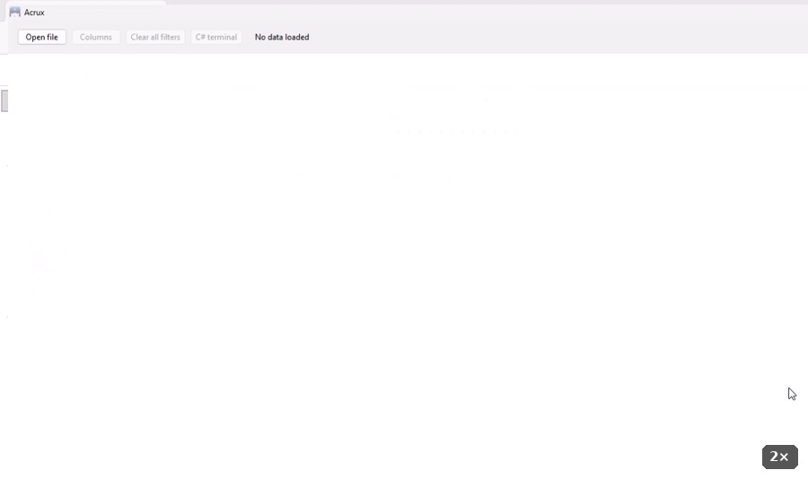
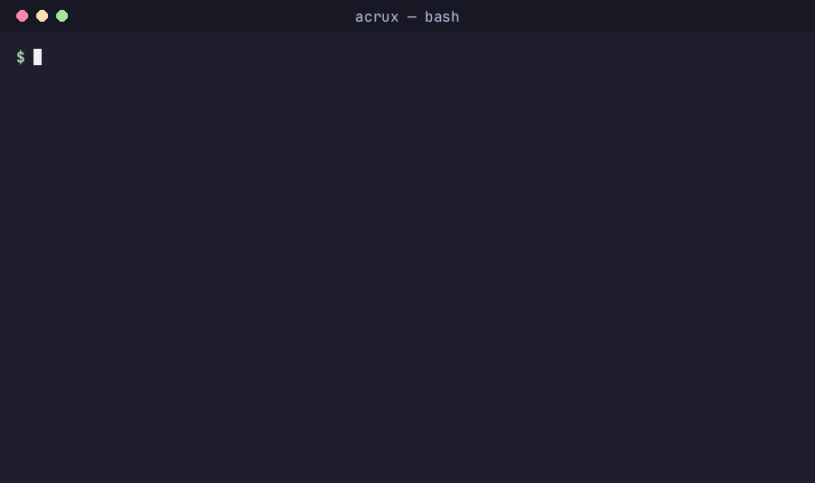
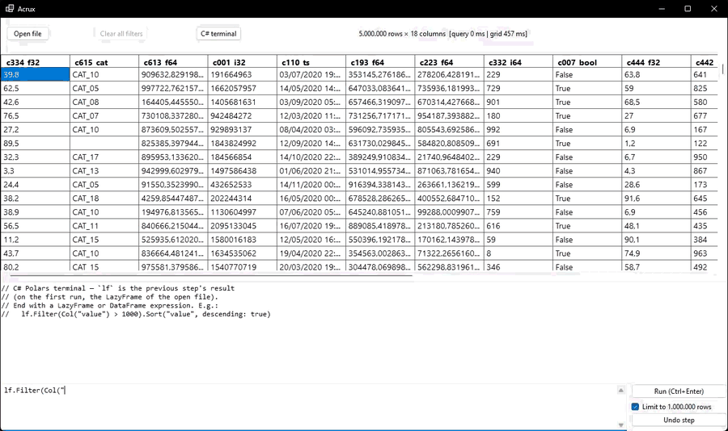

<h1>
  <picture>
    <source media="(prefers-color-scheme: dark)" srcset="assets/brand/acrux-logo-horizontal-gradient.svg">
    
  </picture>
</h1>

Acrux opens the tabular files that are too big or too messy for Excel —
Parquet, CSV, Excel workbooks and SQLite databases — so you can look at them,
filter them and query them without writing a loader first.

Underneath is one core built on [Polars.NET](https://www.nuget.org/packages/Polars.NET).
It works out the format from the file's bytes, types every column by what the
data actually holds, and turns each question into a lazy query that reads only
what it needs. Two front ends sit on top: a Windows desktop grid that never
loads the data it isn't showing, and a command line for a quick look from any
terminal, on Linux or Windows.

<p align="center">
  
  
</p>
<p align="center"><sub>The same 9 GB file, 700 columns × 5 million rows: the desktop app on Windows · the command line in a terminal (click either to enlarge)</sub></p>

## Download

The latest build is on the [Releases](https://github.com/raphaelgaeta/Acrux/releases/latest) page:

- **Windows app** — `Acrux-vX.Y.Z-setup.exe` installs it for your user, no
  admin rights needed. Acrux also needs the Microsoft Visual C++ runtime. If
  your PC doesn't have it, setup downloads it from Microsoft, and Windows asks
  for permission to install it. Setup also puts Acrux in Explorer's
  **Open with** menu for Parquet, CSV, xlsx and SQLite files, and a Parquet
  file opens in Acrux with a double click.
- **Windows app, no install** — `Acrux-vX.Y.Z-win-x64.zip`: unzip it and run
  `Acrux.exe` (the .NET runtime is inside), or drop a file on it. It needs the
  [Microsoft Visual C++ Redistributable (x64)](https://aka.ms/vs/17/release/vc_redist.x64.exe),
  which most PCs already have.
- **Command line, Linux** — `acrux-cli-vX.Y.Z-linux-x64.tar.gz`: extract it and
  put the `acrux-cli` folder on your `PATH`; no .NET needed.

The files aren't code-signed yet, so on first run Windows SmartScreen warns
about an unknown publisher: **More info → Run anyway**. Each release lists the
SHA-256 of its files in `SHA256SUMS`.

## Why this exists

When I started working with data, I got used to how fast Polars and pandas read
large volumes in Python. For big database extracts — especially Parquet files —
I fell into a habit: open the Python terminal, load the file, and write custom
filters to pull out exactly the rows I needed. Doing the same thing in Excel was
frustrating by comparison: rigid built-in functions, heavy processing, and the
long wait just to *open* the file.

But the terminal habit had its own gap. Sometimes I didn't want to write code —
I just wanted to *see* the data: scroll it, click a column, filter it visually,
without spinning up an interpreter for a quick look.

As soon as I found [Polars.NET](https://www.nuget.org/packages/Polars.NET) — the same
Rust engine, now reachable from C# — I saw the read performance I was used to,
and a way to close that gap: a simple, flexible visual environment for the work
I do every day. Open the file, see the grid, click a header to filter like in
Excel, and — when clicking isn't enough — drop into a terminal and query with
real code.

It started as a Parquet viewer. Then the command line, written only to check
that the core ran on Linux, turned out to be a second way in: same files, same
reading path, a different place to look from. The viewer was one face of
something else — a core that reads honestly and chains operations, and front
ends that only decide how you ask and how you see.

## The name

Acrux is α Crucis, the brightest star of the Southern Cross — the constellation
on the Brazilian flag, and the guide star of the sky this project was built
under. Yes, the Polars mascot is a polar bear and polar bears live under the
*northern* star. He didn't mind the trip south.

The logo by [Kat Ribeiro](https://www.instagram.com/design.da.kat/) tells the
same story: the five stars of the Southern Cross around the bear, with Acrux,
the brightest, shining above him.

The bear has a name of his own: **Ginan the Snooper**. Ginan is the official
name of ε Crucis, the faintest of the cross's five stars — the one Brazilians
call *Intrometida*, "the nosy one", for squeezing in among the four bright
stars that draw the cross. A polar bear who came south to snoop around the
sky, now snooping around your data.

## How it fits together

```
Parquet ─┐                                          ┌─► desktop grid  (Windows)
CSV ─────┤   detected       typed by what the       ├─► C# terminal   (inside the app)
Excel ───┼─► by content ──► data holds, queried ────┤
SQLite ──┘                  as one lazy plan        └─► command line  (Linux, Windows)
```

Every format lands in the same shape: a Polars table typed by what the data
actually holds. Every front end does the same two jobs: build a lazy query —
from a header click, a `--last "2 days"` or a line of C# — and show the Arrow
data that comes back. A new format costs one converter; a new front end costs
one renderer, never one per format.

Sharing the path pays off both ways. The command line reads cells through the
exact code the grid uses, so its first run on Linux found column types the
grid had been showing as type names — fixed once, for both.

## Reading honestly

The rule behind every reader: **when the data is ambiguous, Acrux keeps it as
text rather than guess.** A wrong guess looks exactly like a right one, and
nothing downstream can tell.

- **The format comes from the bytes, not the name.** A `.db`, a `.sqlite`, a
  CSV saved as `.txt` or a file with no extension at all just opens. CSV,
  .xlsx and SQLite are converted once to a temporary Parquet file, and the
  desktop app works on Parquet from then on.
- **CSV the way it really comes.** `;` vs `,` separators, decimal commas,
  Excel's "ANSI" (Windows-1252) and UTF-16 encodings, and columns that change
  type a million rows in. Each of those started as a bug report — usually
  mine.
- **Dates stored as text become dates only when they can't be wrong.** ISO
  dates (`2026-11-07`, `2026-11-07T19:47:04Z`) always convert. But
  `07/11/2026` is November 7 in Brazil and July 11 in the US, so a `dd/mm` or
  `mm/dd` column converts only when the data itself proves the order (a `25`
  in the first position settles it); if every value is ≤ 12, it stays text.
  Times with a zone are shown in your local zone.
- **SQLite by what each column holds.** SQLite lets any column hold any type,
  and the usual .NET reader types a column by its first row — a stray `'abc'`
  in an INTEGER column silently becomes 0. Acrux types each column by the
  values it actually holds, so that `'abc'` stays text.
- **Excel, within a simple contract** (read through Polars' native calamine
  engine): headers on row 1, rectangular data, no merged cells — you pick the
  sheet when there's more than one. Excel stores every number as floating
  point, so integer columns arrive as doubles.

## The desktop app (Windows)

- **Pick columns before loading.** Only the selected columns are ever read
  from disk.
- **Filter like Excel.** Click a header, get the distinct values (blanks
  included), check what you want. Filters compose across columns.
- **Drop into a C# terminal.** The full Polars expression API, with `lf` as
  your LazyFrame — starting from exactly what you see: column selection and
  active header filters are inherited by the script as an implicit first step:

  ```csharp
  lf.Filter(Col("city") == "São Paulo")
  lf.GroupBy("product").Agg(Col("value").Sum().Alias("total"))
  ```

  Each command chains on the previous result — applied steps, Power Query
  style — with one-click undo and restore. An optional 1M-row cap saves you
  from accidentally collecting the whole file.

  

## The command line

The same core from a terminal: a quick look without opening an interpreter.
The animation at the top runs it on a 9 GB Parquet file with 700 columns;
below, a SQLite database and a CSV with US dates. A database answers table
by table — adding up or merging different tables gives numbers that mean
nothing.

```
$ acrux schema shop.db
== channels
id    i64
name  str
== messages
channel_id  i64
sent_at     datetime[μs, UTC]
text        str
price       str

$ acrux filter shop.db sent_at --last "2 days"
from 2026-11-06 13:50:15 -03:00 to 2026-11-08 13:50:15 -03:00 (--last "2 days")
== messages
channel_id | sent_at                    | text                | price
-----------+----------------------------+---------------------+------
1          | 2026-11-08 10:20:00 -03:00 | Coffee beans, 1 kg  | 89
2          | 2026-11-07 19:05:00 -03:00 | Wireless headphones | free
(2 rows × 4 columns)
2 matching rows

$ acrux values shop.db price
== messages
45
89
free
(3 values)

$ acrux rows shop.db --where price=free
messages -> 1

$ acrux head us_orders.csv
order | shipped    | code
------+------------+-----------
1     | 2026-01-13 | 01/02/2026
2     | 2026-02-01 | 03/04/2026
3     | 2026-12-25 | 05/06/2026
(3 rows × 3 columns)
```

`price` is text because one row says `free`; `shipped` became a date because
`13` and `25` prove month/day order; `code` stayed text because nothing does.

| Command | What it shows |
|---|---|
| `type <file>` | The detected format, and its tables or sheets |
| `schema <file>` | Every column with its type |
| `columns <file>` | Column names only |
| `rows <file> [--where col=value]...` | Row count — read from Parquet metadata, without the data; with `--where`, the rows that match |
| `values <file> <column> [--where col=value]... [-n N]` | A column's distinct values, sorted (100 by default) |
| `head <file> [-n N]` | The first rows (5 by default) |
| `column <file> <name> [-n N]` | One column's first values (10 by default) |
| `filter <file> <column> --last <span> [-n N]` | Rows from the last span, newest first |
| `version` | The commit a deployed build came from (`scripts/deploy-cli.sh`) |

Spans follow `journalctl` and systemd: `30min`, `1h 30min`, `2 days`, `1M`
(a month — `m` is a minute). The window ends now, so rows dated in the future
stay out. `--where col=value` keeps the rows whose column, as text, is that
value — the same text `values` prints. Repeat it: the same column again is an
OR, another column an AND, and `col=` matches empty cells. Errors are one line
with exit code 1; a usage error exits with 2.

## How it stays fast

Three rules, no exceptions:

1. **Nothing is materialized.** The data lives in Arrow buffers; the grid asks
   for one cell at a time, only for cells on screen. There is no `DataTable`,
   no paging, no copy.
2. **Filters are queries, not loops.** Every filter re-scans the file through
   Polars' lazy engine — which sounds slow and is actually tens of
   milliseconds, because only the filtered columns are read.
3. **Script steps compose one lazy plan.** Chained terminal commands aren't
   executed one by one; they're replayed as a single query, so the optimizer
   sees the whole pipeline.

## Building

```
dotnet build
dotnet run --project src/Acrux.WinForms                       # the desktop app
dotnet run --project src/Acrux.Cli -- schema data.parquet     # the command line
```

The repo is a three-project solution (`Acrux.sln`): `src/Acrux.Core`, the
UI-less core; `src/Acrux.WinForms`, the desktop app; and `src/Acrux.Cli`, the
command line. Needs the .NET 10 SDK. Everything builds on Linux
(`EnableWindowsTargeting`); the desktop app runs only on Windows, and the
command line builds for Linux and Windows (tested on Linux so far). Single-file publishing works for the app —
point it at the app project:

```
dotnet publish src/Acrux.WinForms/Acrux.WinForms.csproj -c Release -r win-x64 --self-contained true -p:PublishSingleFile=true
```

Two hard-earned rules are baked into the project file — don't fight them:
WinForms doesn't support `PublishTrimmed`, and the terminal needs
`IncludeAllContentForSelfExtract` (Roslyn resolves references through
`Assembly.Location`, which is empty inside a pure single-file bundle).

`tests/smoke/run.sh <built acrux binary>` runs every CLI command over small
fixtures and compares the output with `tests/smoke/expected.txt`. Releases are
built by GitHub Actions (`.github/workflows/release.yml`) from a `v*` tag; the
same workflow checks every pull request.

## Dependencies

Everything is restored automatically by `dotnet build` — nothing to install by
hand. The self-contained publish bundles the runtime too, so end users need
nothing at all.

| Package | Version | What it's for |
|---|---|---|
| [Polars.NET](https://www.nuget.org/packages/Polars.NET) (+ `Linq`, `ML`, `Native.win-x64`, `Native.linux-x64`) | 1.0.1 | The data engine — Rust Polars, reachable from C#; the native package matches the OS |
| [Apache.Arrow](https://www.nuget.org/packages/Apache.Arrow) | 23.0.0 | The in-memory columnar format cells are read from (Polars.NET 1.0.1 requires ≥ 23) |
| [Microsoft.Data.Sqlite](https://www.nuget.org/packages/Microsoft.Data.Sqlite) | 10.0.14 | Reads SQLite databases; brings the native SQLite for Windows and Linux |
| [Microsoft.CodeAnalysis.CSharp.Scripting](https://www.nuget.org/packages/Microsoft.CodeAnalysis.CSharp.Scripting) | 5.6.0 | Roslyn — compiles the terminal's C# scripts at runtime |

## Under the hood

| File | Role |
|---|---|
| `src/Acrux.Core/DataFrameProvider.cs` | Format detection by content and CSV/Excel/SQLite→parquet conversion |
| `src/Acrux.Core/TextDates.cs` | Dates stored as text become dates only when unambiguous |
| `src/Acrux.Core/FilterEngine.cs` | Excel-style filters as Polars lazy queries |
| `src/Acrux.Core/TimeFilter.cs` | Relative time windows (`--last "2 days"`) as Polars expressions |
| `src/Acrux.Core/PolarsTableAdapter.cs` | O(1) per-cell reads from Arrow arrays, for every column type |
| `src/Acrux.Core/ScriptHost.cs` | Roslyn evaluation of chained Polars scripts |
| `src/Acrux.WinForms/Program.cs` | Entry point: stale temp sweep and guaranteed process exit |
| `src/Acrux.WinForms/AppIcon.cs` | Window icon, loaded from the embedded `.ico` |
| `src/Acrux.WinForms/MainForm.cs` | Virtual grid, file loading, filter orchestration |
| `src/Acrux.WinForms/ColumnSelectorForm.cs` | Column picker shown on open |
| `src/Acrux.WinForms/SheetSelectorForm.cs` | Sheet or table picker for .xlsx and SQLite |
| `src/Acrux.WinForms/FilterPopupForm.cs` | Distinct-values popup |
| `src/Acrux.WinForms/ScriptTerminalPanel.cs` | Terminal UI (bottom dock) |
| `src/Acrux.Cli/Program.cs` | The command line: one reading route per detected format |

The deeper docs live in [CLAUDE.md](CLAUDE.md): the design principles above in
their strict form, and a catalog of Polars.NET pitfalls. I develop this with
[Claude Code](https://claude.com/claude-code), and every API quirk in that
file was validated in an isolated probe before the app relied on it.

## Status

Personal project, maintained in my free time. Issues and PRs are welcome —
just don't expect an SLA. The desktop app is Windows-only (WinForms); the core
and the command line run on Linux today and build for Windows too, and a
cross-platform desktop front end is the next step being explored.

## License

[MIT](LICENSE) for the code. The logo and icon are not covered by it — see
[assets/brand/NOTICE.md](assets/brand/NOTICE.md).
